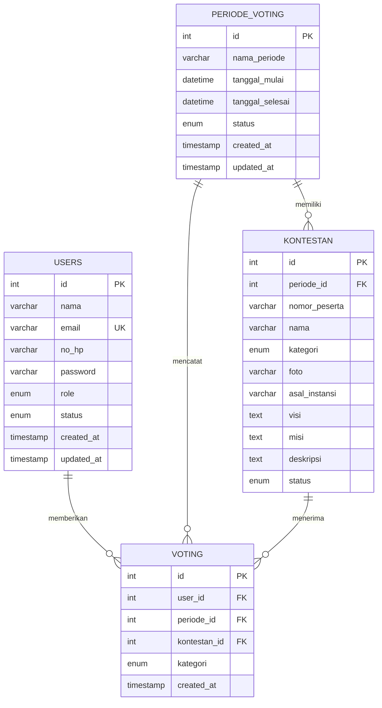

# Struktur Aplikasi dan Database

## Struktur folder

```text
voting-kakang-senduk/
├── admin/
│   ├── dashboard.php
│   ├── hasil.php
│   ├── kontestan.php
│   ├── pemilih.php
│   └── periode.php
├── assets/
│   ├── css/style.css
│   ├── img/logo.png
│   └── js/script.js
├── auth/
│   ├── login.php
│   ├── logout.php
│   └── register.php
├── config/koneksi.php
├── database/
│   ├── db_voting_kakang_senduk.sql
│   └── migrasi-skema-lama.sql
├── docs/desain-database.md
├── includes/
│   ├── app.php
│   └── auth.php
├── pages/
│   ├── detail-kontestan.php
│   ├── klasemen.php
│   ├── kontestan.php
│   └── voting.php
├── proses/admin.php
├── uploads/kontestan/
├── buat-admin.php
├── cek-koneksi.php
└── index.php
```

## ERD



## Aturan relasi

- Satu akun memiliki peran administrator atau pemilih; email disimpan unik.
- Satu periode memuat banyak kontestan dan suara, serta memiliki jadwal dan
  status `Persiapan`, `Aktif`, `Selesai`, atau `Nonaktif`.
- Kontestan berada dalam satu periode dan kategori `Kakang` atau `Senduk`.
  Nomor peserta unik dalam kombinasi periode dan kategori.
- Setiap baris `voting` merujuk ke seorang pengguna, periode, dan kontestan.
  Foreign key gabungan menjaga kategori dan periode suara selalu cocok dengan
  kontestan yang dipilih.
- Indeks unik `(user_id, periode_id, kategori)` membatasi satu suara per
  kategori untuk tiap akun dalam tiap periode, termasuk saat ada permintaan
  yang terkirim bersamaan.
- Hasil dan grafik dihitung dari baris `voting`, bukan dari angka agregat yang
  disimpan terpisah.
- Data pemilih, kontestan, periode, dan suara yang saling terkait tidak dihapus
  diam-diam; foreign key menolak penghapusan yang akan merusak riwayat.

## Instalasi database di XAMPP

Database aplikasi: `db_voting_kakang_senduk`. Kredensial MySQL lokal dapat
diubah di `config/koneksi.php`.

### Instalasi baru

1. Pastikan Apache dan MySQL aktif pada XAMPP.
2. Di phpMyAdmin, pilih **Import** dan impor
   `database/db_voting_kakang_senduk.sql`.
3. Buka `http://localhost/voting-kakang-senduk/buat-admin.php` untuk membuat
   akun administrator pertama. Halaman setup terkunci setelah admin tersedia.
4. Masuk sebagai admin, buat periode pemilihan, tambahkan kontestan Kakang dan
   Senduk, lalu ubah periode menjadi `Aktif` pada rentang waktu yang benar.

### Database lama dari versi sebelumnya

Jika database sudah berisi tabel `users`, `periode_voting`, `kontestan`, dan
`voting`, **jangan impor SQL instalasi baru ke atasnya**. Impor
`database/migrasi-skema-lama.sql` satu kali melalui phpMyAdmin. Migrasi ini
mempertahankan akun dan data lama serta menambahkan relasi periode dan aturan
suara. Untuk kontestan lama tanpa periode, migrasi menyiapkan periode
`Periode Data Lama` berstatus nonaktif.

Pastikan folder `uploads/kontestan/` dapat ditulisi Apache. Foto dibatasi ke
JPG, PNG, atau WebP, maksimal 3 MB.
